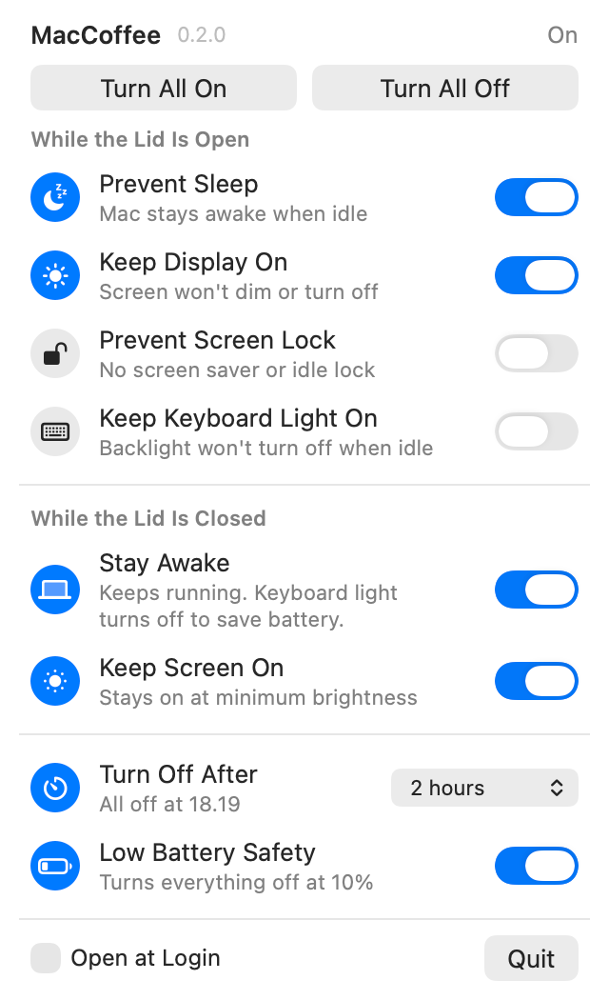

# MacCoffee

A tiny menu bar app that keeps your Mac awake, even with the lid closed.

Close your MacBook, put it in your bag and walk away: downloads, builds, long-running tasks and your iPhone hotspot connection keep going, while the keyboard light stays off to save battery.

<p align="center">
  <picture>
    <source media="(prefers-color-scheme: dark)" srcset="docs/menu-dark.png">
    
  </picture>
</p>

## What it does

**While the lid is open**

- **Prevent Sleep** – your Mac stays awake when you're not using it.
- **Keep Display On** – the screen doesn't dim or turn off.
- **Prevent Screen Lock** – no screen saver and no automatic lock.
- **Keep Keyboard Light On** – the keyboard backlight stays lit when you stop typing.

**While the lid is closed**

- **Stay Awake** – your Mac keeps running with the lid shut, on battery or plugged in. The keyboard light turns off to save battery, and your lid-open settings pick up again when you open it.
- **Keep Screen On** – the screen stays on at minimum brightness instead of turning off. Your brightness comes back when you open the lid.

**And also**

- **Turn All On / Turn All Off** – everything at once.
- **Turn Off After** – a timer from 15 minutes to 12 hours, after which everything turns off.
- **Low Battery Safety** – everything turns off at 10% battery, so a Mac in a bag can't drain flat.
- **Starts fresh** – everything is off when MacCoffee opens, and quitting turns everything off.
- **Open at Login** – if you want it there all the time.

## The menu bar icon

<p align="center">
  
</p>

The cup is empty when everything is off and filled when anything is on. While your Mac is set to stay awake with the lid closed, the coffee steams.

MacCoffee is built to be featherlight: it uses no measurable CPU or battery, whether it's idle or the cup is steaming.

## Requirements

- macOS 14 Sonoma or later
- Apple silicon or Intel
- Xcode or the Command Line Tools to build it (`xcode-select --install`)

## Install

```bash
git clone https://github.com/tembugi/MacCoffee.git
cd MacCoffee
./build.sh --install
```

This builds MacCoffee, copies it to your Applications folder and opens it. Look for the cup in your menu bar.

The first time you turn on **Stay Awake** for a closed lid, macOS asks for your password. It only asks once.

## Uninstall

Quit MacCoffee from its menu and delete `MacCoffee.app` from your Applications folder. If you used **Stay Awake** with the lid closed, also remove the permission you gave it:

```bash
sudo rm /etc/sudoers.d/maccoffee
```

## License

[MIT](LICENSE)
